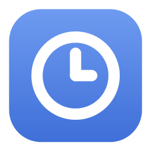
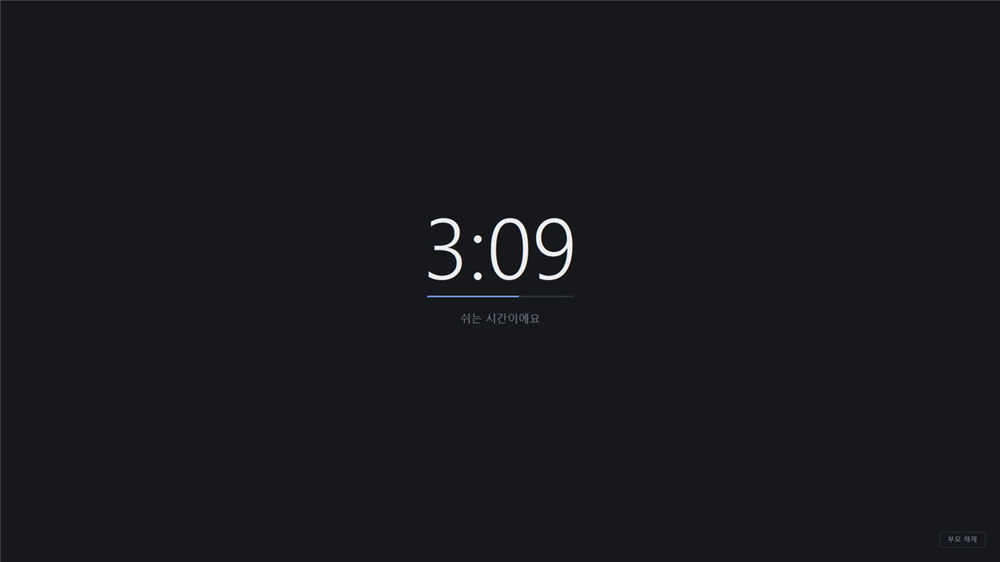
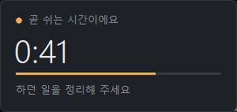
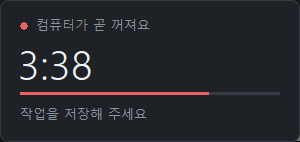
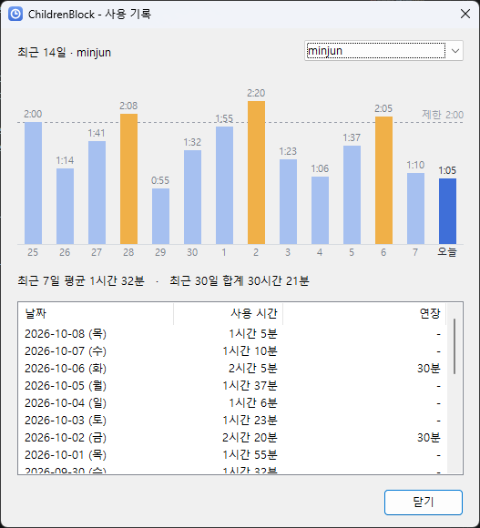
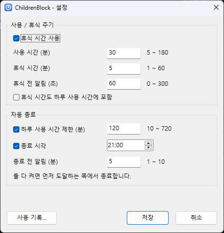

<p align="center">
  
</p>

<h1 align="center">ChildrenBlock</h1>

<p align="center">
  자녀 PC 사용 시간 관리 프로그램 (Windows 10/11)<br>
  사용/휴식 주기 · 휴식 1분 전 알림 · 하루 사용 시간과 종료 시각에 맞춘 자동 종료
</p>

<p align="center">
  
</p>

---

## 주요 기능

- **사용/휴식 주기**: 예를 들어 30분 사용하면 5분 쉽니다. 휴식 중에는 모든 모니터를 어두운 화면으로 덮습니다.
- **휴식 1분 전 알림**: 화면 오른쪽 아래에 카운트다운 카드가 뜹니다. 하던 일을 빼앗지 않도록 포커스를 가져가지 않습니다.
- **자동 종료**: 하루 사용 시간(예: 2시간)이나 종료 시각(예: 21:00)이 되면 PC를 끕니다. 5분 전부터 미리 알려 줍니다.
- **부모 비밀번호**: 설정 변경, 휴식 건너뛰기, 시간 연장, 오늘 제한 해제는 비밀번호가 있어야 합니다.
- **사용 기록**: 최근 14일 그래프, 7일 평균, 날짜별 목록을 자녀 계정별로 보여 줍니다.
- **끄기 어려운 구조**: Windows 서비스로 동작하므로 자녀 계정(표준 사용자)에서는 작업 관리자로도 끌 수 없습니다.

## 화면

| 휴식 1분 전 알림 | PC 종료 알림 |
|:---:|:---:|
|  |  |

| 사용 기록 | 설정 |
|:---:|:---:|
|  |  |

트레이 아이콘의 색으로 상태를 알 수 있습니다. 파랑은 사용 중, 주황은 휴식 임박, 회색은 휴식 중, 빨강은 종료 임박입니다.

## 설치

**요구 사항**: Windows 10/11 64비트, 설치할 때 관리자 권한

### 설치 프로그램

1. [Releases](../../releases)에서 `ChildrenBlockSetup-<버전>.exe`를 내려받아 실행합니다. 직접 만들려면 아래 [빌드](#빌드)를 참고하세요.
2. **제한할 계정**에 자녀의 Windows 계정 이름을 입력합니다.
   - 기본값은 지금 로그인한 계정입니다.
   - 여러 명이면 쉼표로 구분합니다 (`minjun,seoyeon`).
   - 먼저 시험해 보려면 **테스트 모드**를 체크합니다. 휴식과 알림은 그대로 동작하고, PC 종료와 세션 잠금만 하지 않습니다.
3. 설치가 끝나면 **부모 비밀번호**를 등록하고 초기 설정을 입력합니다.

자녀 계정이 이미 로그인해 있으면 몇 초 안에 트레이 아이콘이 나타납니다.

> [!IMPORTANT]
> 자녀 계정은 반드시 **표준 사용자**여야 합니다. 관리자 계정은 서비스를 멈출 수 있어 제한을 우회할 수 있습니다.

자동 설치도 지원합니다. 이때는 비밀번호 등록을 건너뛰므로, 설치 후 관리자 권한으로 'ChildrenBlock 설정'을 실행해 등록하세요.

```
ChildrenBlockSetup-2.0.0.exe /S /USERS=minjun,seoyeon [/DRYRUN]
```

제거는 Windows의 **설정 > 앱**에서 합니다. 제거할 때 설정과 사용 기록도 지울지 묻습니다.

### PowerShell 스크립트

빌드한 결과물을 바로 설치할 때 씁니다. 관리자 PowerShell에서 실행합니다.

```powershell
# 지금 로그인한 계정에 테스트 모드로 설치
powershell -ExecutionPolicy Bypass -File installer\install.ps1 -DryRun

# 자녀 계정 지정
powershell -ExecutionPolicy Bypass -File installer\install.ps1 -ChildUser minjun,seoyeon

# 제거 (-KeepData 를 붙이면 설정·기록을 남김)
powershell -ExecutionPolicy Bypass -File installer\uninstall.ps1
```

## 사용 방법

### 트레이 메뉴

자녀 세션의 트레이 아이콘을 마우스 오른쪽 단추로 누르면 메뉴가 열립니다. 🔒 표시는 부모 비밀번호가 필요합니다.

| 메뉴 | 설명 |
|---|---|
| 사용 기록… | 최근 14일 그래프와 날짜별 기록 |
| 설정… 🔒 | 사용/휴식 시간, 하루 제한, 종료 시각 |
| 휴식 건너뛰기 🔒 | 휴식 임박이거나 휴식 중일 때. 휴식 화면의 **부모 해제** 버튼과 같습니다 |
| 시간 연장 🔒 | 오늘 사용 시간을 15분, 30분, 1시간 늘립니다 |
| 오늘 제한 해제 🔒 | 오늘 하루 휴식·종료 없이 사용합니다. 자정에 자동으로 다시 켜집니다 |
| 비밀번호 변경… 🔒 | |

### 부모 계정에서

설치하면 시작 메뉴에 바로 가기 두 개가 생깁니다.

- **ChildrenBlock 설정**: 비밀번호를 입력하고 설정을 바꿉니다. 저장하면 자녀 계정에 바로 적용됩니다.
- **ChildrenBlock 사용 기록**: 자녀가 둘 이상이면 오른쪽 위에서 계정을 고릅니다.

### 설정 항목

| 항목 | 기본값 | 범위 |
|---|---|---|
| 사용 시간 / 휴식 시간 | 30분 / 5분 | 5~180분 / 1~60분 |
| 휴식 전 알림 | 60초 | 0~300초 |
| 하루 사용 시간 제한 | 120분 | 10~720분 |
| 종료 시각 | 꺼짐 | HH:mm |
| 종료 전 알림 | 5분 | 1~10분 |
| 휴식 시간을 사용 시간에 포함 | 아니오 | |

하루 사용 시간과 종료 시각을 둘 다 켜면 먼저 도달하는 쪽에서 종료합니다. 화면이 잠겨 있는 동안은 사용 시간을 세지 않습니다.

### 비밀번호를 잊었을 때

관리자 권한 명령 프롬프트에서 아래 순서로 실행합니다.

```
"C:\Program Files\ChildrenBlock\ChildrenBlock.exe" /resetpassword
"C:\Program Files\ChildrenBlock\ChildrenBlock.exe" /setup
```

## 동작 방식

```
┌────────────────────────────────┐   Named Pipe   ┌───────────────────────────────┐
│ ChildrenBlockService.exe       │ ◀────────────▶ │ ChildrenBlock.exe (트레이)     │
│ Windows 서비스 (LocalSystem)    │                │ 자녀 세션, 자녀 권한           │
│ · 사용 시간 계산, 휴식·종료 판단 │                │ · 상태 표시, 알림, 휴식 화면   │
│ · 비밀번호 검증, 설정·기록 저장  │                │ · 비밀번호를 받아 서비스로 전달 │
│ · PC 종료, 트레이 실행·감시      │                └───────────────────────────────┘
└────────────────────────────────┘
          │  SYSTEM·관리자만 접근
          ▼
  %ProgramData%\ChildrenBlock\   settings.ini · state-<계정>.ini · log.txt
```

- 서비스는 1초마다 현재 화면의 세션을 확인합니다. 로그인한 사용자가 자녀 계정이면 시간을 계산하고 트레이 앱을 띄웁니다.
- 트레이 앱은 화면에 보여 주는 일만 합니다. 계산, 저장, PC 종료는 모두 서비스가 맡습니다.

### 우회 방지

| 시도 | 대응 |
|---|---|
| 작업 관리자나 `taskkill /f`로 트레이 종료 | 트레이 프로세스에서 사용자의 종료 권한을 없앴습니다 (액세스 거부) |
| 그래도 트레이가 종료됨 | 서비스가 1초 안에 다시 띄웁니다. 휴식 중이었다면 잠금 화면으로 보냅니다 |
| 서비스 중지 | 표준 사용자에게는 권한이 없습니다 |
| 설정·기록 파일 수정 | 데이터 폴더는 SYSTEM과 관리자만 접근할 수 있습니다 |
| 재부팅, 시계 변경 | 상태를 계속 저장하고, 시간은 단조 시계로 측정합니다 |
| 비밀번호 무작위 대입 | 5회 틀리면 5분간 잠깁니다 |
| 가짜 서버로 비밀번호 가로채기 | 사용자는 파이프를 만들 수 없고, 트레이는 서비스(세션 0)에만 연결합니다 |

## 빌드

**필요한 것**
- Visual Studio 2022: "C++를 사용한 데스크톱 개발" 워크로드와 **MFC** 구성 요소
- 설치 프로그램을 만들 때: [NSIS 3](https://nsis.sourceforge.io/)

```powershell
# 서비스, 트레이, 테스트 빌드 → bin\x64\Release\
msbuild ChildrenBlock.sln /p:Configuration=Release /p:Platform=x64

# 단위 테스트
bin\x64\Release\ChildrenBlock.Tests.exe

# 설치 프로그램 → bin\ChildrenBlockSetup-<버전>.exe
& "C:\Program Files (x86)\NSIS\makensis.exe" installer\ChildrenBlock.nsi
```

MFC를 정적으로 링크하므로 실행 파일만 있으면 됩니다. 별도 런타임을 설치할 필요가 없습니다.

### 개발 · 테스트

서비스를 설치하지 않고 콘솔에서 바로 실행할 수 있습니다. 콘솔 모드는 기본적으로 PC를 끄지 않습니다.

```powershell
# Debug 빌드: 실제 설치와 섞이지 않게 데이터 폴더와 파이프 이름을 따로 지정
$env:CHILDRENBLOCK_DATADIR = "$env:TEMP\cbtest"
$env:CHILDRENBLOCK_PIPE    = "ChildrenBlockTest"
bin\x64\Debug\ChildrenBlockService.exe --console --child-all --speed 60
```

| 옵션 | 설명 |
|---|---|
| `--console` | 현재 사용자로 실행 (Ctrl+C로 종료) |
| `--child-all` | 모든 계정을 자녀로 취급 |
| `--speed N` | 시간을 N배 빠르게 진행 |
| `--unprotected-tray` | 트레이 보호를 끔 (재실행 테스트용) |
| `--dryrun` | PC 종료·세션 잠금 생략 (서비스 모드에서도 사용 가능) |

- 아이콘을 다시 만들 때: `tools\make-icons.ps1`
- README 스크린샷을 다시 찍을 때: `tools\capture-screenshots.ps1` (Debug 빌드 필요)

## 프로젝트 구조

```
shared/      서비스·트레이 공용 (ScheduleEngine 상태 머신, 설정·기록 저장, 비밀번호 해시, 파이프 프로토콜)
service/     Windows 서비스 (세션 추적, 요청 처리, 트레이 감시, PC 종료)
src/         트레이·설정·사용 기록 UI (MFC)
tests/       ScheduleEngine 단위 테스트
installer/   NSIS 스크립트, PowerShell 설치·제거 스크립트
tools/       아이콘·스크린샷 생성 스크립트
docs/images/ README 이미지
```

설계와 개발 과정은 [PLAN.md](PLAN.md)에 정리되어 있습니다.

## 알려진 제한

- 자녀 계정이 관리자이면 제한을 우회할 수 있습니다.
- 안전 모드로 부팅하면 서비스가 실행되지 않습니다. BIOS/UEFI 비밀번호로 부팅 옵션을 막아 두는 것을 권장합니다.
- 전체 화면 독점 모드 게임에서는 휴식 화면이 가려질 수 있습니다.
- 휴식 중에도 Windows 키로 시작 메뉴는 열립니다. 휴식 화면은 매초 다시 맨 위로 올라옵니다.
- 지금은 모든 자녀 계정에 같은 설정이 적용됩니다.
